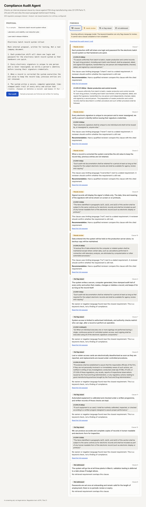

# Compliance Audit Agent

Paste an internal proposal and get a clause-by-clause audit against FDA drug manufacturing rules, with the exact paragraph and a verbatim quote behind every finding. A citation the software cannot find word for word in the regulation is removed before you see it.

**Live demo:** https://satwik-kotta.github.io/compliance-audit-agent/

The hosted demo has no server: it replays pre-computed audits of the three sample proposals using the keyword baseline. To audit your own text, or to use the LLM analyst, run the app locally or deploy it (see Deploy).

Corpus: 21 CFR Part 11 (electronic records and signatures) and Parts 210 and 211 (current good manufacturing practice), 73 sections split into 305 citable passages.



## How it works

```
proposal text
   │
   ▼
ClauseExtractor ──► RetrievalAgent ──► AnalystAgent ──► CitationVerifier ──► ReportWriter
 one commitment      BM25 + dense        LLM: verdict,     plain code: is the     markdown
 per clause          (FAISS), fused      passage id,       quote really in the    audit report
                                         verbatim quote    cited passage?
```

| Agent | Job | Uses an LLM |
|---|---|---|
| ClauseExtractor | Split the proposal into individual commitments | No |
| RetrievalAgent | Find the five passages most likely to govern each clause | No |
| AnalystAgent | Judge the clause against those passages only; return verdict, passage id, quote | Yes |
| CitationVerifier | Reject any citation that was not retrieved or whose quote is not in the passage; downgrade the verdict to "needs review" | No |
| ReportWriter | Assemble the audit report | No |

The verifier is ordinary string matching on purpose. It is the control that makes a wrong citation impossible to display, and it is covered by tests that feed the pipeline a fabricated quote, an out-of-corpus citation and malformed model output.

**Passages.** Each one carries the citation a reviewer would write, such as `21 CFR 211.84(d)(2)`, and the lead-in sentence of its parent paragraph.

**Retrieval.** BM25 and a dense index vote, fused by reciprocal rank. The dense vectors are TF-IDF reduced to 128 dimensions (latent semantic analysis) in a FAISS index: no model download, no API call, and the index builds in under a second. `Embedder` in `retrieval.py` is the place to swap in a neural encoder.

**Analyst.** A LangChain chain (prompt → chat model → Pydantic parser). Claude is used if `ANTHROPIC_API_KEY` is set, OpenAI if `OPENAI_API_KEY` is set. With neither, a keyword baseline runs instead: it can flag a clause for review but never calls one compliant or non-compliant.

## Results

Scored on 36 hand-labelled clauses in three fictional proposals (20 violations, 16 compliant), `python -m eval.run_eval`.

**Retrieval: is the governing section in the top results?**

| Ranker | Top 1 | Top 3 | Top 5 |
|---|---|---|---|
| BM25 | 86% | 92% | 94% |
| Dense (LSA + FAISS) | 75% | 81% | 83% |
| Hybrid (default) | 78% | 89% | 92% |

BM25 alone did best here. The test clauses were written from the regulation text, so they share its vocabulary, which favours lexical matching.

**Keyword baseline (no LLM):** flagged 14 of 20 violations with 1 false alarm, and cited the right section for 9 of those 14.

**LLM analyst: not yet measured.** No API key was available when this was built. The LLM path is tested with a simulated model for parsing and citation checking only. Run `make eval` with a key set to fill this in; results are written to `eval/results.json`.

## Limits

- The gold labels are the author's reading of the regulations, not a compliance professional's.
- 36 clauses is a small test set, and the baseline's keyword list was written alongside it, so its score is optimistic.
- Three parts of one CFR title. Guidance documents, warning letters and other titles are not covered.
- Regulation text comes from a GitHub mirror synced through 2025. Check ecfr.gov for current wording.
- The verifier proves the quote exists, not that the model's reasoning about it is right. This is a screening aid, not legal advice.

## Run it

```bash
pip install -r requirements.txt
make ui            # builds the React app into frontend/dist
make api           # http://localhost:8000
make test
make eval
```

Optional, to use the LLM analyst:

```bash
export ANTHROPIC_API_KEY=...     # or OPENAI_API_KEY=...
export ANTHROPIC_MODEL=...       # optional override; see backend/app/config.py
```

For front-end development run `npm run dev` in `frontend/`; it proxies `/api` to port 8000.

## Deploy

One container serves the API and the built front end.

1. On Render: New → Blueprint → pick this repository. `render.yaml` and the `Dockerfile` do the rest.
2. Optionally set `ANTHROPIC_API_KEY` or `OPENAI_API_KEY` in the service's environment.
3. Add the service URL to the top of this README.

The static demo on GitHub Pages is rebuilt with `make pages`, which writes `docs/`.

## API

| Method | Path | Returns |
|---|---|---|
| GET | `/api/health` | Corpus size and which analyst is active |
| GET | `/api/samples` | The three sample proposals |
| POST | `/api/audit` | `{text, title}` → findings, counts, markdown report |
| GET | `/api/passages/{id}` | Full text of one passage, e.g. `211.84(d)(2)` |

## Layout

```
backend/app/   corpus.py · retrieval.py · agents.py · llm.py · main.py
frontend/      React (Vite)
eval/          gold.json (36 labelled clauses), run_eval.py, results.json
tests/         parser, retrieval, verifier and API tests
data/          regulation sections and sample proposals
```
